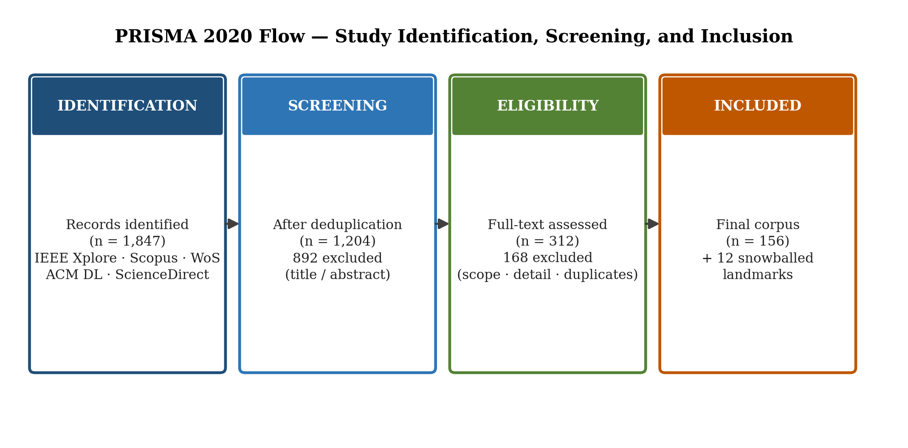

# From Data to Market Value in Virtual Power Plants: A Structured Evidence Review of Decision Integrity, Uncertainty, and Electricity–Carbon Market Integration

*[Author names, affiliations and corresponding-author e-mail — to be inserted]*

**Abstract**—Virtual power plants (VPPs) are evolving into data-intensive decision systems that coordinate distributed energy resources, forecasts, uncertainty representations, multi-market bidding and, increasingly, carbon-related value streams. Existing reviews cover architectures, data-driven energy management, uncertainty-aware bidding and market taxonomies, but they rarely test whether a reported gain survives the full chain from information to settlement. This structured, PRISMA-informed evidence review shifts the unit of analysis from the algorithm to that chain. A three-database search retrieved {{N_IDENTIFIED}} records ({{N_AFTER_DEDUP}} after deduplication) and was used to audit the coverage of a coded core of {{N_CORE}} studies ({{N_PRIM}} primary studies and {{N_REV}} reviews); {{RECALL_PCT}}% of the core studies with a DOI were retrieved by the search. We introduce Data-to-Market Decision Integrity (DMDI), a diagnostic coding instrument, not a validated standard, with seven dimensions, explicit coding rules and a maturity ladder. Among the {{N_PRIM}} primary studies, decision integrity and market realism were explicitly reported in {{D_E}} and {{M_E}}, whereas out-of-sample validity ({{O_E}}), settlement realism ({{S_E}}) and reproducibility ({{R_E}}) were rarely explicit; the number of studies at the settlement-aware level or above was {{N_L5PLUS}}. Weighted inter-coder agreement on {{N_DOUBLE}} double-coded studies was κ = {{KAPPA}}. Electricity–carbon coupling is an active frontier, but few studies model carbon clearing and settlement jointly with the electricity bid. The review closes with an agenda for settlement-aware benchmarking, chronological out-of-sample evaluation as a reporting norm, and explicit carbon-accounting boundaries.

**Index Terms**—Virtual power plants, data-driven energy management, decision integrity, uncertainty representation, distributionally robust optimization, bidding strategy, carbon–electricity markets, out-of-sample validation, settlement, evidence review.

# I. INTRODUCTION

Virtual power plants (VPPs) aggregate heterogeneous distributed energy resources (DERs), such as renewable generation, battery storage, flexible loads and electric-vehicle (EV) fleets, and convert dispersed flexibility into market value [1], [2], [3]. That conversion rests on a data-intensive chain: measurements define the physical state of the portfolio, forecasts anticipate uncertain supply and demand, optimization turns this information into schedules and bids, and market clearing and settlement determine the value that is actually realized.

Recent reviews document the breadth of the field. Ruan *et al.* [4] adopt a data-lifecycle view of VPP energy management; Gao *et al.* [5] and Kaiss *et al.* [6] review coordination, architectures and operation strategies; Naval and Yusta [7] classify VPP models by market interaction; Esfahani *et al.* [8] expose a persistent theory–practice gap; and Zare *et al.* [9] classify VPP interaction with electricity, flexibility and carbon markets. These works leave a methodological question open: when a study reports a better forecast, a more sophisticated optimization or a higher simulated profit, what evidence shows that the decision was valid at the time it was made, and that its value survives clearing, physical deviation and settlement?

This review treats VPP operation as an end-to-end chain (Information → Forecast → Uncertainty → Decision → Bid → Clearing → Dispatch → Deviation → Settlement → Realized value) and asks four research questions.

- **RQ1.** How completely do VPP studies report the evidence needed to trust a decision along this chain?
- **RQ2.** To what extent does reported forecasting or AI performance translate into decision and market value?
- **RQ3.** How are electricity-market and carbon-market decisions coupled?
- **RQ4.** How mature is the evidence, from synthetic simulation to settlement-aware and field-validated operation?

The contributions are: (i) the DMDI coding instrument with explicit per-dimension rules (Section IV); (ii) a rule-based Data-to-Market Maturity Ladder; (iii) a study-level evidence profile that separates forecast quality, decision quality and realized market value; and (iv) a study-level audit of electricity–carbon coupling depth. DMDI and the ladder are proposed by this review; they are diagnostic tools, not validated external standards.

Section II describes the methods, Section III positions the review, Section IV defines DMDI, Section V relates it to decision-integrity threats, Sections VI–X report results, Section XI gives the research agenda, and Sections XII–XIII state limitations and conclusions.

# II. METHODOLOGY

## A. Design and Reporting

The review is a structured evidence review reported against PRISMA 2020 [10]: the flow diagram (Fig. 1) and the search, selection and synthesis items are reported; the protocol was not pre-registered. PRISMA is used as a reporting framework, not as a quality metric.

## B. Information Sources and Search

Scopus, Web of Science Core Collection and IEEE Xplore were searched for the period 2018–2026, with pre-2018 and foundational works cited only for formalism. Six term blocks were combined into five queries, each intersecting the VPP block (B1) with one topical block:

```
B1 ("virtual power plant" OR "VPP" OR "virtual aggregator" OR "flexibility aggregator")
B2 ("energy management" OR "scheduling" OR "dispatch" OR "self-scheduling" OR "unit commitment")
B3 ("uncertainty" OR "stochastic programming" OR "robust optimization" OR "distributionally robust"
    OR "polynomial chaos" OR "chance-constrained" OR "conditional value-at-risk" OR "CVaR" OR "risk-averse")
B4 ("deep learning" OR "reinforcement learning" OR "multi-agent reinforcement learning" OR "data-driven"
    OR "digital twin" OR "federated learning")
B5 ("bidding" OR "electricity market" OR "day-ahead market" OR "intraday market" OR "balancing market"
    OR "ancillary service" OR "reserve market" OR "imbalance settlement" OR "pay-as-bid" OR "pay-as-clear")
B6 ("carbon market" OR "carbon trading" OR "carbon emission flow" OR "green certificate" OR "emission allowance")
S1 = B1 AND B2;  S2 = B1 AND B3;  S3 = B1 AND B4;  S4 = B1 AND B5;  S5 = B1 AND B6
```

The queries were applied to title, abstract and keywords (Scopus), topic (Web of Science) and metadata and full text (IEEE Xplore). Table I reports the execution log.

**TABLE I — SEARCH EXECUTION LOG**

{{TABLE_SEARCH_LOG}}

## C. Eligibility Criteria

Records were eligible if they were English-language peer-reviewed journal articles, review articles or substantive conference papers published in 2018–2026 with direct relevance to VPP or virtual-aggregator energy management, scheduling, bidding, uncertainty, market participation, data-driven methods, carbon coupling or deployment. Duplicates, abstracts only, records with peripheral VPP relevance and records with insufficient technical detail were excluded. Preprints were not coded.

## D. Selection Process

Records were deduplicated by DOI and then by normalized title and year. Automated filters removed records outside the period, language or document-type criteria and records lacking both a VPP term and a topical term in the title, abstract or keywords. The remaining {{N_TA_SCREENED}} records were screened on title and abstract and then on full text by a single screener using the criteria above. Fig. 1 shows the flow.



## E. Coded Core and Coverage Audit

In-depth DMDI coding was applied to a coded core of {{N_CORE}} studies ({{N_PRIM}} primary studies and {{N_REV}} reviews). The core was assembled before the formal search, through supervised large-language-model-assisted searching and citation chaining from the seed reviews [4], [5], [6], [8], [9]; every entry was verified against a bibliographic source (Section II-H). Because this route is not a database-frozen sample, the formal search serves as a coverage audit: {{N_CORE_RECALLED}} of the {{N_CORE_DOI}} core studies with a DOI were retrieved by the search strings (recall {{RECALL_PCT}}%), and studies not retrieved are identified in the supplementary file.

## F. Data Extraction and Coding

Each primary study was coded on seven DMDI dimensions (Table III) as Explicit (E), Partial (P) or Not reported (NR), and assigned a data type (conceptual, synthetic, historical or real data, pilot, operational). Review articles were not coded on the seven dimensions. {{N_FULLTEXT}} of the {{N_PRIM}} primary studies were coded on full text; the remainder were coded on the abstract and the accessible parts of the article, so that NR means "not reported in the material examined". A second coder independently recoded {{N_DOUBLE}} primary studies, and agreement was measured with linearly weighted Cohen's κ (NR < P < E): overall κ = {{KAPPA}} (per-dimension range {{KAPPA_RANGE}}). Studies were not pooled quantitatively because market structures, datasets and objectives are heterogeneous.

## G. Study Quality

DMDI measures how completely evidence is reported along the decision chain. It is not a risk-of-bias instrument, and no validated risk-of-bias tool exists for computational bidding studies. We therefore report evidence completeness, not bias-adjusted effect sizes, and we do not rank studies by a composite score.

## H. Reference Verification

Each reference was checked against publisher or DOI metadata (author list, venue, volume and pages) and against the claim attributed to it. DOIs were additionally compared with Crossref records by script, and entries that could not be matched to a verifiable publication were removed from the coded core.

# III. EXISTING REVIEWS AND POSITIONING

Table II positions this review against prior reviews. The comparison is between analytical lenses, not between review quality.

**TABLE II — POSITIONING AGAINST PRIOR REVIEWS**

| Review | Stated focus | Evidence unit |
|---|---|---|
| Ruan *et al.* [4] | Data lifecycle, learning methods, privacy, market participation, projects | Themes |
| Gao *et al.* [5]; Kaiss *et al.* [6] | Resource coordination, architectures, operation strategies | Models and architectures |
| Naval and Yusta [7] | VPP models by formulation, solution technique and market participation | Models |
| Esfahani *et al.* [8] | Platforms, pilots and real-world applications | Deployments |
| Zare *et al.* [9]; Wang *et al.* [11] | Market-coupling classification; carbon-related VPP review | Market and carbon taxonomies |
| Mo *et al.* [12]; Singh *et al.* [13] | DRL-based bidding; uncertainty management and bidding | Method families |
| **This review** | Decision-time information, uncertainty validity, market realism, settlement | **Study-level evidence along the chain** |

To our knowledge, none of the prior reviews codes each study for decision-time information, out-of-sample validity and settlement evidence; this review adds that audit rather than repeating their topic coverage.

# IV. THE DMDI FRAMEWORK

## A. Decision Chain


DMDI follows the chain in Fig. 2. It separates three evidence layers that are related but not interchangeable: forecast quality (FQ, error on held-out data), decision quality (DQ, objective value under the information available at the decision gate) and realized market value (MV, value after clearing, deviation and settlement). Improvement at one layer does not imply improvement at the next. Because balancing markets often apply asymmetric imbalance prices, a slightly less accurate but imbalance-aware forecast can yield higher realized value than a more accurate imbalance-agnostic one; we use this as an interpretive lens, not as a quantified literature-wide finding.

## B. Dimensions and Coding Rules

**TABLE III — DMDI DIMENSIONS AND CODING RULES**

| Dimension | Explicit (E) | Partial (P) | Not reported (NR) |
|---|---|---|---|
| I — Information-set integrity | Information available at each decision gate (forecast issue time, gate closure, known prices) is stated and no later data enter the decision | Information set partly stated or only implied | Not stated |
| U — Uncertainty integrity | Uncertainty model fitted to named empirical data and validated (calibration, coverage or dependence check) | Fitted without validation, or assumed with sensitivity analysis | Assumed without justification |
| D — Decision integrity | Objective, constraints and recourse fully specified and evaluated without look-ahead | Partly specified | Not specified |
| M — Market realism | Named real market with products, timing and clearing rules | Generic or stylized market | Not specified |
| O — Out-of-sample validity | Chronological split or rolling window, test period later than and disjoint from fitting, results reported on the held-out period | Temporal separation mentioned but incomplete or pooled with in-sample | Not discussed |
| S — Settlement realism | Reported profit or cost computed after a stated deviation or imbalance-settlement rule | Penalty term inside the objective or ex-ante deviation cost only | Not modeled |
| R — Reproducibility | A reader can rebuild the experiment from the stated data source, parameters and protocol without contacting the authors | Parameters or data partly reported | Not reported |

## C. Maturity Ladder

The Data-to-Market Maturity Ladder places each primary study on one level by a deterministic rule (Table IV). It describes the strength of validation evidence, not the scientific quality of an algorithm: a novel formulation evaluated on synthetic data sits lower than a simple heuristic tested in a pilot for reasons unrelated to mathematical merit.

**TABLE IV — MATURITY LADDER ASSIGNMENT RULES**

| Level | Rule |
|---|---|
| 0 | Conceptual formulation without numerical evaluation |
| 1 | Synthetic or fully assumed data |
| 2 | Historical or real data, retrospective evaluation |
| 3 | Level 2 and O = E or P |
| 4 | Level 3 and M = E |
| 5 | Level 4 and S = E |
| 6 | Pilot or field validation |
| 7 | Sustained operational deployment with documented performance |

# V. DECISION-INTEGRITY LAYERS

DMDI codes what a study reports. A complementary question is what could invalidate a market-facing decision regardless of what is reported. Table V lists representative threats and countermeasures in four layers; it is a qualitative map from the cited literature, not a coded measurement of the core, and no maturity scores are attached to it.

**TABLE V — REPRESENTATIVE DECISION-INTEGRITY THREATS AND COUNTERMEASURES**

| Layer (closest DMDI dimensions) | Representative threats | Representative countermeasures |
|---|---|---|
| Data (I, R) | Corrupt telemetry; false data injection [14], [15]; profit-oriented attacks on market-facing data [16] | Bad-data detection; redundant metering; market-currency threat models [16] |
| Model (U, D) | Distribution shift; adversarial perturbation of learned models [17]; miscalibrated scenario sets | Calibration diagnostics; distributionally robust formulations [18]; tail control with CVaR [19]; protection against unknown uncertainty horizons with info-gap theory [20] |
| Execution (M, S) | Infeasible offers; baseline gaming in carbon accounting; settlement disputes | Pre-submission feasibility screening; decomposition-based coordination [21]; ledger-anchored audit trails [22] |
| Governance (R) | Opaque bidding agents; prosumer privacy exposure; unverifiable carbon claims | Federated learning [23]; digital-twin stress tests [24]; logging and replication standards |

Paradigm choice is itself an information commitment. Stochastic programming is optimal in expectation only when the scenario distribution is credible; robust optimization buys feasibility at a measurable price of robustness [25]; distributionally robust optimization hedges against distributional error [18]; info-gap theory protects against severe non-probabilistic uncertainty [20]. DMDI ratings for U and D must therefore be read against the guarantee a study claims, not as if all paradigms targeted the same one.

# VI. RESULTS: OVERALL EVIDENCE PROFILE

Table VI and Fig. 3 give the DMDI profile of the {{N_PRIM}} primary studies of the coded core. Complete study-level codes are in Supplementary Table S1.

**TABLE VI — DMDI EVIDENCE COVERAGE, PRIMARY STUDIES OF THE CODED CORE**

{{TABLE_COVERAGE}}


Decision integrity ({{PCT_D_E}}% explicit) and market realism ({{PCT_M_E}}% explicit) are the best-reported dimensions, which is expected because an optimization model must state its constraints and market. Out-of-sample validity, settlement realism and reproducibility are explicit in {{O_E}}, {{S_E}} and {{R_E}} of {{N_PRIM}} studies. The R rule is demanding by design (replication without author contact), so its low explicit count partly reflects a floor effect; the direction of the O, S and R weakness is more reliable than the exact counts. For a study that makes no deployment claim, NR on O or S describes the evidence offered, not a defect of the study. Coding basis and single-screener selection also qualify the counts (Section XII).

# VII. RESULTS: INFORMATION, UNCERTAINTY, DECISION AND FORECAST EVIDENCE

Uncertainty handling in the coded core spans stochastic programming with scenario trees [26], [27], [28], robust and interval-robust formulations [29], [30], and distributionally robust formulations [31], [32], [33], [34], [35], [36], [37]; all distributionally robust studies in the core appeared in 2024 or later. Heuristic and learning-based bidding and scheduling appear in [38], [39], [40], [41], [42], [43]. Table VII lists representative studies with their DMDI codes.

**TABLE VII — REPRESENTATIVE STUDIES AND THEIR DMDI CODES**

{{TABLE_REPRESENTATIVE}}

Methodological sophistication does not establish uncertainty validity. Three distinctions matter. First, representation differs from calibration: a distribution can be embedded in a model without showing that it reproduces the real error distribution. Second, marginal accuracy differs from dependence integrity: separately calibrated wind, PV, load and price distributions may fail to reproduce cross-variable and temporal dependence. Third, in-sample differs from out-of-sample risk control: CVaR is decision-relevant only if the loss distribution used for evaluation reflects conditions encountered after the bid is fixed.

Forecasting studies strengthen the first layer of the chain. Examples are transfer and adversarial learning for data-scarce PV [44], correction of forecast error from day-ahead to balancing markets [45] and BiLSTM-based long-horizon forecasting [46]. A forecasting paper that reports lower error without a demonstrated operational or bidding consequence provides predictive evidence only, not market-value evidence. Learning-based decision studies [47], [48], [49], [50] report policy performance, but most do not show temporal hold-out results (Table VII). A recent robust bidding study [51] is a useful contrast: it evaluates on real-world campus data in Shenzhen and compares a data-driven polyhedral robust model within one study with stochastic, robust and distributionally robust baselines, but the evaluation is retrospective and not a settlement-aware field deployment. It was published after the core was assembled and is therefore not coded.

# VIII. RESULTS: MARKET AND SETTLEMENT EVIDENCE

Market realism is comparatively well established; settlement realism is not (Table VI). Studies that model pay-as-bid and pay-as-clear rules with imbalance penalties [52] and that link DER portfolio composition to settlement outcomes [53] show why settlement deserves independent treatment: a study can model clearing realistically (M = E) and still report profit from the ex-ante objective (S = P or NR). Fig. 4 maps out-of-sample and settlement evidence; points in the upper-right region are studies whose results carry both temporal and settlement support. Studies with explicit temporal hold-out and real business data, such as [26] and [31], model settlement only partially.


The most consequential pattern is that the chain Objective value → Cleared value → Delivered value → Settled value is rarely reported in full. This does not mean the reported gains are wrong; many studies deliberately target theoretical upper-bound performance. It does mean that a reported profit improvement should be read as an objective-value or cleared-value claim unless the study states otherwise. We call this the *Optimization-to-Settlement Evidence Gap* and recommend that studies state which of the four stages their headline number corresponds to.

# IX. RESULTS: ELECTRICITY–CARBON MARKET INTEGRATION

Carbon coupling is classified two ways. Table VIII lists six mechanism archetypes describing how the literature structures the coupling; Table IX codes six levels of coupling depth for representative carbon-relevant studies in the core.

**TABLE VIII — ELECTRICITY–CARBON COUPLING ARCHETYPES**

| # | Archetype | Mechanism | Integrity caveat |
|---|---|---|---|
| A1 | Exogenous carbon adder | Carbon price added to fossil marginal cost outside the decision model | Ignores carbon-price uncertainty |
| A2 | Emission-flow accounting | Network carbon intensities attributed to loads or VPP nodes, e.g., [54] | Depends on flow-data integrity; allocation disputes |
| A3 | Sequential two-stage trading | Electricity cleared first, carbon settled later | Weak dispatch-time incentive |
| A4 | Hierarchical co-optimization | Leader–follower or bi-level coordination, e.g., [55] | Computational burden; equilibrium selection |
| A5 | Joint clearing | Energy and environmental value co-cleared | Nascent design; liquidity concerns |
| A6 | Tiered carbon pricing | Marginal carbon price rises with emission bands | Baseline setting is decisive |

The six coupling levels are: (1) accounting, an emission factor is reported but not used in the decision; (2) objective, a carbon cost or revenue term is in the objective; (3) constraint, emissions or allowances enter as a constraint; (4) market participation, the VPP trades in a modeled carbon or green-certificate market; (5) clearing, carbon-market price formation is modeled rather than exogenous; (6) settlement and coupled decision, realized carbon value is computed after settlement and the electricity bid is shown to respond to carbon conditions.

**TABLE IX — COUPLING LEVEL OF REPRESENTATIVE CARBON-RELEVANT STUDIES**

| Study | 1 Accounting | 2 Objective | 3 Constraint | 4 Market participation | 5 Clearing | 6 Settlement / coupled decision |
|---|---|---|---|---|---|---|
| Liu [38] | Yes | Yes | Yes | Yes | Partial | Partial |
| Liu *et al.* [56] | Yes | Yes | Yes | Yes | Partial | NR |
| Fan and Liu [33] | Yes | Yes | Yes | Yes | Partial | Partial |
| Bian *et al.* [55] | Yes | Yes | Yes | Yes | Partial | NR |
| Siqin *et al.* [37] | Yes | Yes | Yes | Yes | Partial | NR |
| Singh *et al.* [57] | Yes | Yes | Partial | Yes | NR | NR |

Most of these studies reach Levels 2–4; none demonstrates Level 5 or 6 in full. The field has moved beyond treating carbon as a static accounting term, but few studies show that carbon-market clearing and settlement interact dynamically with the electricity-side decision. Prior reviews classify carbon and flexibility market participation [9], [11]; the audit contribution here is at study level, asking whether carbon value is evaluated through a settlement-consistent, uncertainty-aware model. We do not claim that no carbon-focused review exists.

A sharper gap follows from the coding. At the generation-fleet and policy level, the coupling of carbon trading and tradable green certificates has been shown to alter investment behavior and price formation [58], and border carbon pricing follows the same "price on a subset of the mix" logic [59]. At the aggregator level, the coded studies mostly treat the carbon price as a scalar in the objective or an exogenous series, and explicit allowance buy, bank and sell decisions with the carbon price as a full uncertainty object are essentially absent from the core. The missing element is not a new algorithm, since two-market distributionally robust programming exists [33], [37], but its transplantation to the aggregator, where assets are behind the meter and a carbon-displacement claim is only as credible as the metering behind it. This conclusion is conditional on the coverage of the coded core (Section II-E). Studies on carbon-green-certificate scheduling [42] and forecast-linked carbon bidding [57] illustrate the active primary research.

# X. RESULTS: MATURITY OF THE EVIDENCE

**TABLE X — DISTRIBUTION OF PRIMARY STUDIES ON THE MATURITY LADDER**

{{TABLE_LADDER}}


{{PCT_LE2}}% of primary studies sit at Level 2 or below, and the number at Level 5 or above is {{N_L5PLUS}} (Table X, Fig. 5). Pilot-context evidence comes mainly from reviews of deployments [8], [9], which report that real-world implementations remain limited and short [9]. The pattern is consistent with the theory–practice gap described in [8].

# XI. DISCUSSION AND RESEARCH AGENDA

The binding constraint on VPP research is not the supply of advanced optimization or learning methods but the incomplete validation of the information-to-settlement pathway. Five actions follow.

1. **Settlement-aware benchmarking.** Standard open benchmarks with realistic imbalance settlement rules would make studies comparable. Studies should report scheduled energy, delivered energy, deviations, penalties and settlement prices separately.
2. **Chronological out-of-sample evaluation as a reporting norm.** Random train/test splits break the temporal dependence of price and renewable series. Studies should state a decision-time information table listing what is known at each gate.
3. **From uncertainty representation to validation.** Scenario and ambiguity sets should be evaluated for calibration, coverage, dependence and tail behavior, not only for mathematical treatment.
4. **Carbon coupling with explicit accounting boundaries.** Reports should state the coupling level and archetype (Tables VIII and IX), the emission-factor treatment and the metering basis of displacement claims, and should treat the carbon price as an uncertainty object.
5. **Efficient methods with field-grade data.** Computationally efficient uncertainty representations combined with real operational data and settlement rules remain largely undemonstrated.

**TABLE XI — PROPOSED REPORTING METRICS FOR FUTURE STUDIES**

| Metric | Purpose | DMDI link |
|---|---|---|
| Out-of-sample forecast error (MAE, RMSE) | Predictive accuracy on unseen periods | O |
| Prediction-interval coverage (PICP) and CRPS | Probabilistic calibration | U |
| Scenario dependence and tail-dependence error | Dependence integrity of scenario sets | U |
| CVaR at 95% and profit volatility across test periods | Tail risk of realized profit | U, D |
| Schedule–execution deviation (%) | Physical delivery fidelity | D |
| Imbalance volume and relative deviation cost | Settlement exposure | S |
| Objective-minus-settled profit discrepancy | Optimization-to-settlement gap | S |
| Constraint violation rate | Physical and market feasibility | D, M |
| Solve time and decision latency | Deployability | R |

These metrics are reporting variables, not a composite score, because they measure distinct failure modes.

# XII. LIMITATIONS

First, the protocol was not pre-registered and screening was performed by a single screener. Second, the coded core was assembled by supervised LLM-assisted search and citation chaining before the formal search; the coverage audit (Section II-E) quantifies but does not remove this selection risk. Third, {{N_FULLTEXT}} of {{N_PRIM}} primary studies were coded on full text, so NR can partly reflect limited access; double coding covered {{N_DOUBLE}} studies. Fourth, DMDI, the ladder and Table V are proposals of this review, not validated standards; the R rule is strict and produces a floor effect. Fifth, heterogeneity in markets, datasets and objectives prevents pooled effect sizes. Sixth, the coded core was not stratified by market jurisdiction, and the search covers three databases and English-language peer-reviewed sources, so grey literature, regulator reports and industrial pilots are under-represented. Seventh, reference verification relied on bibliographic records, and two initially listed studies that could not be matched to a verifiable publication were excluded from the core.

# XIII. CONCLUSION

This review organizes VPP research around the data-to-market decision chain and shows that forecast accuracy, optimization sophistication and realized market value are distinct evidence claims. Within the coded core, decision integrity and market realism are well reported, while out-of-sample validity, settlement realism and reproducibility are weak, so most reported profit improvements are objective-value or cleared-value claims. Electricity–carbon coupling is an active frontier in which carbon clearing and settlement are seldom modeled jointly with the electricity bid. The DMDI instrument and maturity ladder offer an auditable, appropriately hedged basis for more settlement-aware, temporally rigorous and field-validated VPP research.

# Acknowledgment

Artificial-intelligence use is disclosed in accordance with IEEE policy. Claude (Anthropic) was used to support literature identification, reference checking, first-pass evidence coding, drafting and language editing of all sections, and to draft the Python code that generates Tables I and VI–VII and Figs. 1–5. Elicit was used for exploratory literature discovery. The authors verified every reference against bibliographic records, reviewed and edited all AI-assisted text and code, performed the coding reported in Section II-F, and take full responsibility for the content. The coding matrix, screening sheet and scripts are available at [repository DOI — to be inserted on deposit].

# References

[1] G. Zhang, C. Jiang, and X. Wang, “Comprehensive review on structure and operation of virtual power plant in electrical system,” *IET Gener. Transm. Distrib.*, vol. 13, pp. 145–156, 2019, doi: 10.1049/iet-gtd.2018.5880.

[2] L. Yavuz, A. Önen, S. M. Muyeen, and I. Kamwa, “Transformation of microgrid to virtual power plant—A comprehensive review,” *IET Gener. Transm. Distrib.*, vol. 13, pp. 1994–2005, 2019, doi: 10.1049/iet-gtd.2018.5649.

[3] M. Rahimiyan and L. Baringo, “Real-time energy management of a smart virtual power plant,” *IET Gener. Transm. Distrib.*, vol. 13, pp. 2015–2023, 2019, doi: 10.1049/iet-gtd.2018.5637.

[4] G. Ruan, D. Qiu, S. Sivaranjani, A. S. A. Awad, and G. Strbac, “Data-driven energy management of virtual power plants: A review,” *Adv. Appl. Energy*, vol. 14, Art. no. 100170, 2024, doi: 10.1016/j.adapen.2024.100170.

[5] H. Gao, T. Jin, C. Feng, C. Li, Q. Chen, and C. Kang, “Review of virtual power plant operations: Resource coordination and multidimensional interaction,” *Appl. Energy*, vol. 357, Art. no. 122284, 2024, doi: 10.1016/j.apenergy.2023.122284.

[6] M. Kaiss, Y. Wan, D. Gebbran, C. U. Vila, and T. Dragičević, “Review on virtual power plants/virtual aggregators: Concepts, applications, prospects and operation strategies,” *Renew. Sustain. Energy Rev.*, vol. 211, Art. no. 115242, 2025, doi: 10.1016/j.rser.2024.115242.

[7] N. Naval and J. M. Yusta, “Virtual power plant models and electricity markets—A review,” *Renew. Sustain. Energy Rev.*, vol. 149, Art. no. 111393, 2021, doi: 10.1016/j.rser.2021.111393.

[8] M. Esfahani, A. Alizadeh, B. Cao, I. Kamwa, and M. Xu, “Bridging theory and practice: A comprehensive review of virtual power plant technologies and their real-world applications,” *Renew. Sustain. Energy Rev.*, vol. 222, Art. no. 115929, 2025, doi: 10.1016/j.rser.2025.115929.

[9] A. Zare, M. Shafie-khah, P. Siano, and G. C. Lazaroiu, “A systematic review of virtual power plant configurations and their interaction with electricity, carbon, and flexibility markets,” *Renew. Sustain. Energy Rev.*, vol. 226, Art. no. 116448, 2026, doi: 10.1016/j.rser.2025.116448.

[10] M. J. Page *et al.*, “The PRISMA 2020 statement: An updated guideline for reporting systematic reviews,” *BMJ*, vol. 372, Art. no. n71, 2021, doi: 10.1136/bmj.n71.

[11] G. Wang, Z. Lin, Y. Chen, R. Qiu, H. Zhang, and J. Yan, “Carbon-billed future for virtual power plants: A comprehensive review,” *Renew. Sustain. Energy Rev.*, vol. 217, Art. no. 115719, 2025, doi: 10.1016/j.rser.2025.115719.

[12] P. Mo *et al.*, “Deep reinforcement learning-based bidding strategies for virtual power plants in electricity spot markets: A review,” *IEEE Access*, vol. 14, pp. 50628–50643, 2026, doi: 10.1109/ACCESS.2026.3678911.

[13] K. N. Singh, A. K. Goswami, N. B. D. Choudhury, T. S. Ustun, and U. Cali, “Virtual power plants in modern power systems: A comprehensive review of uncertainty management and market bidding strategies,” *IEEE Access*, vol. 14, pp. 75331–75355, 2026, doi: 10.1109/ACCESS.2026.3691418.

[14] Y. Liu, P. Ning, and M. K. Reiter, “False data injection attacks against state estimation in electric power grids,” *ACM Trans. Inf. Syst. Secur.*, vol. 14, no. 1, Art. no. 13, 2011, doi: 10.1145/1952982.1952995.

[15] G. Liang, J. Zhao, F. Luo, S. R. Weller, and Z. Y. Dong, “A review of false data injection attacks against modern power systems,” *IEEE Trans. Smart Grid*, vol. 8, no. 4, pp. 1630–1638, 2017, doi: 10.1109/TSG.2015.2495133.

[16] Q. Zhang, F. Li, Q. Shi, K. Tomsovic, J. Sun, and L. Ren, “Profit-oriented false data injection on electricity market: Reviews, analyses, and insights,” *IEEE Trans. Ind. Informat.*, vol. 17, no. 9, pp. 5876–5886, 2021, doi: 10.1109/TII.2020.3036104.

[17] I. J. Goodfellow, J. Shlens, and C. Szegedy, “Explaining and harnessing adversarial examples,” in *Proc. Int. Conf. Learn. Represent. (ICLR)*, San Diego, CA, USA, 2015.

[18] P. Mohajerin Esfahani and D. Kuhn, “Data-driven distributionally robust optimization using the Wasserstein metric: Performance guarantees and tractable reformulations,” *Math. Program.*, vol. 171, nos. 1–2, pp. 115–166, 2018, doi: 10.1007/s10107-017-1172-1.

[19] R. T. Rockafellar and S. Uryasev, “Optimization of conditional value-at-risk,” *J. Risk*, vol. 2, no. 3, pp. 21–41, 2000, doi: 10.21314/JOR.2000.038.

[20] Y. Ben-Haim, *Info-Gap Decision Theory: Decisions Under Severe Uncertainty*, 2nd ed. Oxford, U.K.: Academic Press, 2006.

[21] S. Boyd, N. Parikh, E. Chu, B. Peleato, and J. Eckstein, “Distributed optimization and statistical learning via the alternating direction method of multipliers,” *Found. Trends Mach. Learn.*, vol. 3, no. 1, pp. 1–122, 2011, doi: 10.1561/2200000016.

[22] M. Andoni *et al.*, “Blockchain technology in the energy sector: A systematic review of challenges and opportunities,” *Renew. Sustain. Energy Rev.*, vol. 100, pp. 143–174, 2019, doi: 10.1016/j.rser.2018.10.014.

[23] H. B. McMahan, E. Moore, D. Ramage, S. Hampson, and B. A. y Arcas, “Communication-efficient learning of deep networks from decentralized data,” in *Proc. Int. Conf. Artif. Intell. Statist. (AISTATS)*, Fort Lauderdale, FL, USA, 2017, pp. 1273–1282.

[24] F. Tao, H. Zhang, A. Liu, and A. Y. C. Nee, “Digital twin in industry: State-of-the-art,” *IEEE Trans. Ind. Informat.*, vol. 15, no. 4, pp. 2405–2415, 2019, doi: 10.1109/TII.2018.2873186.

[25] D. Bertsimas and M. Sim, “The price of robustness,” *Oper. Res.*, vol. 52, no. 1, pp. 35–53, 2004, doi: 10.1287/opre.1030.0065.

[26] D. Wozabal and G. Rameseder, “Optimal bidding of a virtual power plant on the Spanish day-ahead and intraday market for electricity,” *Eur. J. Oper. Res.*, vol. 280, no. 2, pp. 639–655, 2020, doi: 10.1016/j.ejor.2019.07.022.

[27] M. Vahedipour-Dahraie, H. Rashidizadeh-Kermani, A. Anvari-Moghaddam, and P. Siano, “Risk-averse probabilistic framework for scheduling of virtual power plants considering demand response and uncertainties,” *Int. J. Elect. Power Energy Syst.*, vol. 121, Art. no. 106126, 2020, doi: 10.1016/j.ijepes.2020.106126.

[28] D. Falabretti, F. Gulotta, and D. Siface, “Scheduling and operation of RES-based virtual power plants with e-mobility: A novel integrated stochastic model,” *Int. J. Elect. Power Energy Syst.*, vol. 144, Art. no. 108604, 2023.

[29] Y. Chen, Y. Niu, M. Du, and J. Wang, “A two-stage robust optimization model for a virtual power plant considering responsiveness-based electric vehicle aggregation,” *J. Clean. Prod.*, vol. 405, Art. no. 136690, 2023, doi: 10.1016/j.jclepro.2023.136690.

[30] Y. Ma *et al.*, “Data-driven interval robust optimization method of VPP bidding strategy in spot market under multiple uncertainties,” *Appl. Energy*, vol. 384, Art. no. 125366, 2025, doi: 10.1016/j.apenergy.2025.125366.

[31] S. Kim and H. Choi, “A sample robust optimal bidding model for a virtual power plant,” *Eur. J. Oper. Res.*, vol. 316, no. 3, pp. 1101–1113, 2024, doi: 10.1016/j.ejor.2024.03.001.

[32] W. Li, “The virtual power plant bidding strategy model based on multi-stage semi-anticipativity distributionally robust optimization,” *Elect. Power Syst. Res.*, vol. 237, Art. no. 111015, 2024, doi: 10.1016/j.epsr.2024.111015.

[33] Q. Fan and D. Liu, “A Wasserstein-distance-based distributionally robust chance constrained bidding model for virtual power plant considering electricity-carbon trading,” *IET Renew. Power Gener.*, vol. 18, no. 3, pp. 545–557, 2024, doi: 10.1049/rpg2.12806.

[34] W. Li, F. Dong, Z. Ji, and P. Wang, “Internal and external coordinated distributionally robust bidding strategy of virtual power plant operator participating in day-ahead electricity spot and peaking ancillary services markets,” *Appl. Energy*, vol. 386, Art. no. 125514, 2025, doi: 10.1016/j.apenergy.2025.125514.

[35] C. Song, Y. Yuan, and L. Dai, “Distributionally robust optimization of virtual power plant bidding strategies considering discrete scenario-based uncertainties in day-ahead market prices and wind powers,” *Elect. Power Syst. Res.*, vol. 248, Art. no. 111977, 2025, doi: 10.1016/j.epsr.2025.111977.

[36] M. Esfahani, A. Alizadeh, N. Amjady, and I. Kamwa, “A distributed VPP-integrated co-optimization framework for energy scheduling, frequency regulation, and voltage support using data-driven distributionally robust optimization with Wasserstein metric,” *Appl. Energy*, vol. 361, Art. no. 122883, 2024, doi: 10.1016/j.apenergy.2024.122883.

[37] Z. Siqin, R. Diao, and M. Zhao, “Two-stage distributionally robust bidding strategies for multi-energy virtual power plants in energy, reserve and carbon markets,” *Energy*, vol. 334, Art. no. 137455, 2025, doi: 10.1016/j.energy.2025.137455.

[38] X. Liu, “Research on bidding strategy of virtual power plant considering carbon-electricity integrated market mechanism,” *Int. J. Elect. Power Energy Syst.*, vol. 137, Art. no. 107891, 2022, doi: 10.1016/j.ijepes.2021.107891.

[39] C. Yang *et al.*, “Optimal bidding strategy of renewable-based virtual power plant in the day-ahead market,” *Int. J. Elect. Power Energy Syst.*, vol. 144, Art. no. 108557, 2023, doi: 10.1016/j.ijepes.2022.108557.

[40] S. Mei, Q. Tan, A. Trivedi, and D. Srinivasan, “A two-step optimization model for virtual power plant participating in spot market based on energy storage power distribution considering comprehensive forecasting error of renewable energy output,” *Appl. Energy*, vol. 376, Art. no. 124234, 2024.

[41] Y. Li, W. Chang, and Q. Yang, “Deep reinforcement learning based hierarchical energy management for virtual power plant with aggregated multiple heterogeneous microgrids,” *Appl. Energy*, vol. 382, Art. no. 125333, 2025, doi: 10.1016/j.apenergy.2025.125333.

[42] J. Jin, X. Pang, B. Wang, D. Wang, and Z. Zheng, “Optimal scheduling method of carbon-green certificate trading virtual power plant via Q-learning-enhanced particle swarm algorithm,” *Complex Intell. Syst.*, vol. 12, Art. no. 51, 2026, doi: 10.1007/s40747-025-02176-1.

[43] L. Xie, G. Li, M. Xu, X. Dong, and Z. Tan, “Optimizing virtual power plant coordination through locational marginal flexibility under network constraints,” *Sci. Rep.*, vol. 16, Art. no. 3789, 2026, doi: 10.1038/s41598-025-33726-9.

[44] Y. Wang, W. Fu, J. Wang, Z. Zhen, and F. Wang, “Ultra-short-term distributed PV power forecasting for virtual power plant considering data-scarce scenarios,” *Appl. Energy*, vol. 373, Art. no. 123890, 2024, doi: 10.1016/j.apenergy.2024.123890.

[45] R. Nadimi and M. Goto, “Uncertainty reduction in power forecasting of virtual power plant: From day-ahead to balancing markets,” *Renew. Energy*, vol. 238, Art. no. 121875, 2025, doi: 10.1016/j.renene.2024.121875.

[46] R. Nadimi and M. Goto, “A novel decision support system for enhancing long-term forecast accuracy in virtual power plants using bidirectional long short-term memory networks,” *Appl. Energy*, vol. 382, Art. no. 125273, 2025, doi: 10.1016/j.apenergy.2025.125273.

[47] S. Sadeghi, H. Jahangir, B. Vatandoust, M. A. Golkar, A. Ahmadian, and A. Elkamel, “Optimal bidding strategy of a virtual power plant in day-ahead energy and frequency regulation markets: A deep learning-based approach,” *Int. J. Elect. Power Energy Syst.*, vol. 127, Art. no. 106646, 2021, doi: 10.1016/j.ijepes.2020.106646.

[48] S. Sadeghi Gougheri *et al.*, “Optimal participation of a virtual power plant in electricity market considering renewable energy: A deep learning-based approach,” *Sustain. Energy Grids Netw.*, vol. 26, Art. no. 100448, 2021, doi: 10.1016/j.segan.2021.100448.

[49] B. Xu *et al.*, “Integrated three-stage decentralized scheduling for virtual power plants: A model-assisted multi-agent reinforcement learning method,” *Appl. Energy*, vol. 376, Art. no. 123985, 2024, doi: 10.1016/j.apenergy.2024.123985.

[50] H.-C. Wu, D. Qiu, L. Zhang, and M. Sun, “Adaptive multi-agent reinforcement learning for flexible resource management in a virtual power plant with dynamic participating multi-energy buildings,” *Appl. Energy*, vol. 374, Art. no. 123998, 2024, doi: 10.1016/j.apenergy.2024.123998.

[51] X. Lei, H. Yu, J. Zhong, Z. Shao, and L. Jian, “A data-driven robust optimal day-ahead bidding strategy considering V2G operation for distribution-system-side virtual power plant,” *Energy*, vol. 338, Art. no. 138795, 2025.

[52] Y. Song, Y. Chu, Y. Yoon, and Y. Jin, “Virtual power plant bidding strategies in pay-as-bid and pay-as-clear markets: Analysis of imbalance penalties and market operations,” *Energies*, vol. 18, no. 6, Art. no. 1383, 2025, doi: 10.3390/en18061383.

[53] E. J. Choi, G.-S. Seo, and S. W. Kim, “Are better combinations of DERs more profitable? Combinatorial optimization for aggregation of DERs in wholesale electricity markets,” *Appl. Energy*, vol. 396, Art. no. 126264, 2025, doi: 10.1016/j.apenergy.2025.126264.

[54] Y. W. Wang, J. Xu, W. Pei, H. Wang, and Z. Zhang, “Low-carbon economic scheduling of virtual power plant considering carbon emission flow and demand response,” *Front. Energy Res.*, vol. 12, 2024, doi: 10.3389/fenrg.2024.1398655.

[55] J. Bian, J. Cheng, H. Wang, G. Li, and S. Li, “CVaR-based bi-level bidding strategy for VPP to participate in energy-regulation-carbon markets,” *Int. J. Elect. Power Energy Syst.*, vol. 174, Art. no. 111555, 2026, doi: 10.1016/j.ijepes.2025.111555.

[56] R. Liu, K. Chen, G. Sun, S. Lin, and C. Jiang, “Bidding strategy for the virtual power plant based on cooperative game participating in the electricity-carbon joint market,” *Int. J. Elect. Power Energy Syst.*, vol. 163, Art. no. 110325, 2024, doi: 10.1016/j.ijepes.2024.110325.

[57] K. N. Singh *et al.*, “A risk-aware bidding model for virtual power plants: Integrating renewable energy forecasting and carbon market strategies,” *Energy Rep.*, pp. 1222–1239, 2025, doi: 10.1016/j.egyr.2025.07.032.

[58] X. Chang *et al.*, “The coupling effect of carbon emission trading and tradable green certificates under electricity marketization in China,” *Renew. Sustain. Energy Rev.*, vol. 187, Art. no. 113750, 2023, doi: 10.1016/j.rser.2023.113750.

[59] C. Böhringer, C. Fischer, K. E. Rosendahl, and T. F. Rutherford, “Potential impacts and challenges of border carbon adjustments,” *Nat. Clim. Change*, vol. 12, no. 1, pp. 22–29, 2022, doi: 10.1038/s41558-021-01250-z.
